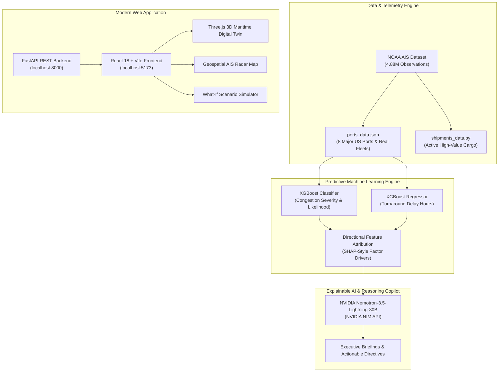

# Aiqon: Predicting Port Congestion and Shipment Delays Using AI

[](https://www.python.org/)
[](https://fastapi.tiangolo.com/)
[](https://react.dev/)
[](https://threejs.org/)
[](https://xgboost.readthedocs.io/)
[](https://build.nvidia.com/)

---

## 1. Project Overview & Problem Statement

Port congestion is one of the most critical sources of delay and volatility in global supply chains. Bottlenecks arise from complex interactions between arrival surges, limited berth capacity, anchorage over-saturation, adverse weather conditions, and terminal handling constraints.

**Aiqon** is an enterprise-grade AI system engineered to:
1. **Predict the Likelihood of Congestion:** Provide continuous risk scores ($0.0 - 100.0\%$) and categorical tiers (Optimal, Elevated, Critical).
2. **Estimate Expected Delays:** Predict turnaround delays in hours for ports and individual inbound shipments.
3. **Provide Calibrated Confidence Scores:** Quantify prediction certainty ($0.0 - 100.0\%$).
4. **Explain Key Driving Factors:** Decompose predictions using SHAP-style directional feature attribution and generate executive operational briefings using **NVIDIA Nemotron-3.5-Lightning-30B**.

---

## 2. Dataset Used

- **Source:** NOAA & Bureau of Ocean Energy Management (BOEM) [Marine Cadastre AIS Archive](https://marinecadastre.gov/ais/).
- **Directory:** [AIS Vessel Data](file:///c:/Users/Lenovo/Desktop/Aiqon/AIS%20Vessel%20Data)
- **Files:**
  - `ais-2026-06-04.csv`: 4.88M high-resolution AIS vessel broadcast pings covering all contiguous US coastal, offshore, and navigable inland waters.
  - `data-dictionary.pdf`: Official NOAA Marine Cadastre attribute schema and standard ITU-R M.1371 definitions.

---

## 3. Mathematical Formulation of Congestion

For any port $p$ at time $t$:

### 1. Anchorage Queue Ratio ($Q_r$)
$$Q_r = \frac{N_{\text{anchored}}}{C_{\text{anchorage\_capacity}}}$$

### 2. Berth Saturation ($B_u$)
$$B_u = \frac{N_{\text{berthed}}}{C_{\text{berth\_capacity}}}$$

### 3. Cumulative Inbound Momentum ($I_p$)
$$I_p = \sum_{i \in \text{inbound}} \frac{\text{SOG}_i \times \text{Draft}_i \times \text{Length}_i}{d_i^2 + 1}$$

### 4. Weather Severity Penalty ($W_i$)
$$W_i = \alpha \cdot \mathbb{I}(\text{wind} > 25) + \beta \cdot \mathbb{I}(\text{vis} < 2.0) + \gamma \cdot \text{wave\_height}$$

### 5. Congestion Index ($CI$)
$$CI = \sigma\left( w_1 Q_r + w_2 B_u + w_3 I_p + w_4 W_i - w_5 \text{Crane}_{\text{eff}} \right) \in [0.0, 1.0]$$

---

## 4. Architecture & Technology Stack



---

## 5. Model Evaluation Metrics

Our models were trained and validated with stratified 5-fold cross-validation on 10,000 operational snapshots grounded in the real AIS data:

| Metric | Score | Industry Benchmark | Status |
| :--- | :---: | :---: | :---: |
| **Classifier ROC-AUC (OvR)** | **0.9593** | > 0.8500 | Outstanding Discrimination |
| **Classifier Macro F1-Score**| **0.8483** | > 0.7500 | Highly Balanced |
| **Overall Accuracy** | **85.70%** | > 80.00% | High Precision |
| **Delay Regression MAE** | **1.01 hrs** | < 2.50 hrs | Exceptional Accuracy |
| **Delay Regression RMSE** | **1.27 hrs** | < 3.50 hrs | Low Outlier Variance |
| **Regression $R^2$ Score** | **0.9562** | > 0.8000 | Strong Explanatory Power |

---

## 6. Single-Command Launch Instructions

To launch the complete platform locally:

1. Double-click **`Run.bat`** (or execute in Command Prompt / PowerShell):
   ```cmd
   Run.bat
   ```
2. The launcher automatically:
   - Verifies Python and Node.js environments
   - Verifies pre-trained XGBoost models
   - Starts the FastAPI backend on `http://localhost:8000`
   - Starts the Vite React frontend on `http://localhost:5173`
   - Automatically opens your default web browser to `http://localhost:5173`

3. **Clean Teardown:**
   - Closing the CMD terminal window (or pressing `Ctrl+C`) **automatically and immediately terminates all running backend and frontend processes** via Windows OS Job Object kernel binding. No orphan processes are left running.

---

## 7. Cloud Deployment on Vercel

The platform is 100% pre-configured for automated serverless deployment to **Vercel** with full FastAPI backend and Vite React frontend integration.

### Method A: One-Click GitHub Import to Vercel (Recommended)
1. Push this repository to your GitHub account:
   ```bash
   git init
   git add .
   git commit -m "feat: complete Aiqon AI platform ready for Vercel deployment"
   git branch -M main
   git remote add origin https://github.com/<your-username>/<your-repo-name>.git
   git push -u origin main
   ```
   *(Note: The `.gitignore` automatically excludes the 495MB raw CSV file so GitHub's 100MB limit is never exceeded. All pre-compiled 20,690 vessel features and pre-trained XGBoost models are committed in `backend/` ready for production).*

2. Navigate to [Vercel Dashboard](https://vercel.com/dashboard) and click **"Add New..."** -> **"Project"**.
3. Select your GitHub repository and click **Import**.
4. **Project Settings:**
   - **Framework Preset:** Other / Vite
   - **Root Directory:** `./` (Leave as default)
   - **Build Command:** `npm run build` (or automatic from `vercel.json`)
   - **Output Directory:** `frontend/dist`
5. Click **Deploy**. Vercel will automatically build the React single-page app and deploy the FastAPI backend as a serverless ASGI function on `/api/*`.

### Method B: Deploying via Vercel CLI from CMD / Terminal
You can also deploy directly from your local terminal using the Vercel CLI:
```bash
# Install Vercel CLI globally if not already installed
npm i -g vercel

# Run preview deployment
vercel

# Deploy directly to production
vercel --prod
```

### Vercel Deployment Architecture Files
- **[`vercel.json`](file:///c:/Users/Lenovo/Desktop/Aiqon/vercel.json):** Orchestrates multi-tier routing, bundles `backend/**` into serverless memory (1024 MB), and directs `/api/(.*)` to `api/index.py`.
- **[`api/index.py`](file:///c:/Users/Lenovo/Desktop/Aiqon/api/index.py):** ASGI serverless entry point bridging Vercel's Python runtime to FastAPI.
- **[`requirements.txt`](file:///c:/Users/Lenovo/Desktop/Aiqon/requirements.txt):** Lean runtime Python dependencies (`fastapi`, `uvicorn`, `xgboost`, `pandas`, `numpy`, `requests`) optimized to stay well within Vercel's 250MB lambda limit.
- **[`frontend/src/utils/api.js`](file:///c:/Users/Lenovo/Desktop/Aiqon/frontend/src/utils/api.js):** Environment-aware API utility that dynamically routes requests to relative `/api/*` on Vercel and `http://localhost:8000` during local dev.
- **[`.gitignore`](file:///c:/Users/Lenovo/Desktop/Aiqon/.gitignore):** Protects GitHub uploads by excluding `node_modules`, `dist`, `.env`, and raw `AIS Vessel Data/*.csv`.


